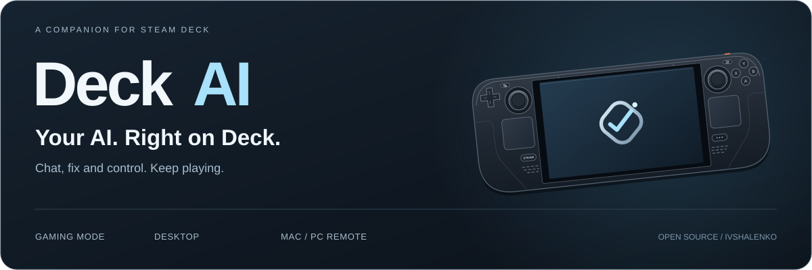
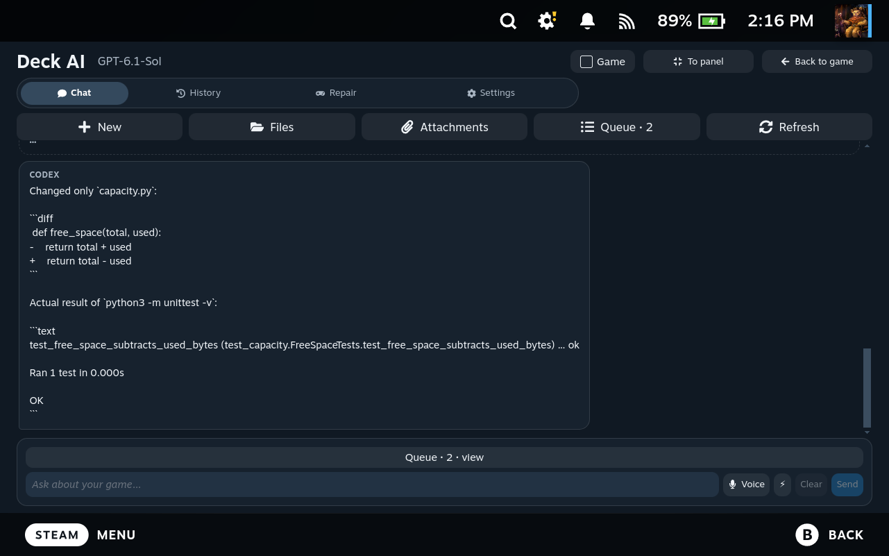
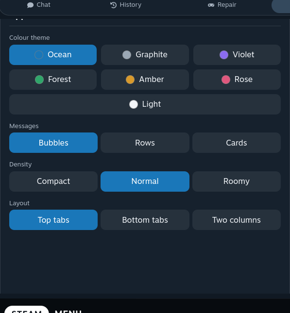
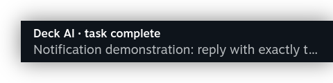
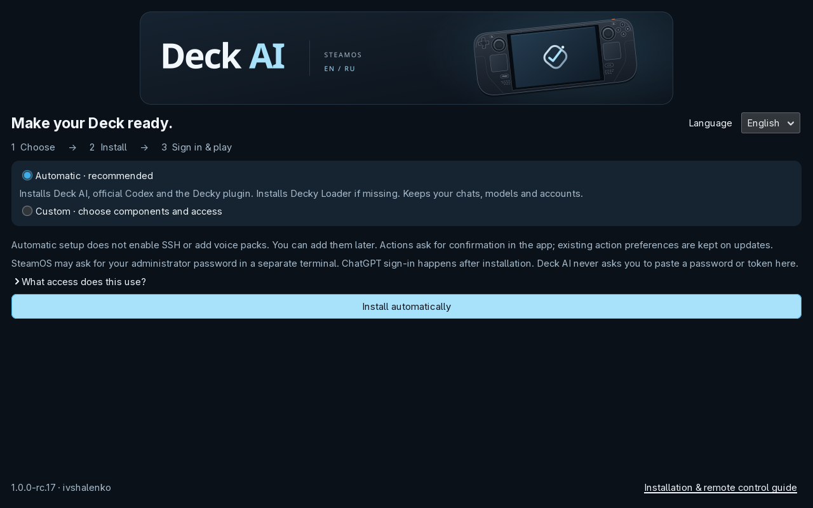
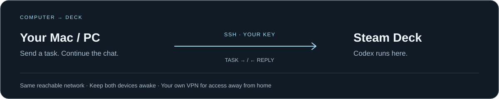

[English](README.md) · [Russian](docs/README.ru.md)

[](https://github.com/ivshalenko/codex-steamdeck/actions/workflows/checks.yml) [](https://github.com/ivshalenko/codex-steamdeck/releases/tag/v1.0.0-rc.24) [](docs/QUICKSTART.md) [](LICENSE)

**Ask for help, investigate a launch error, or send a task from your Mac.** Deck AI puts Codex in your Steam Deck's Quick Access menu, with full-screen chat, action confirmations, attachments and completion notifications. A desktop companion and SSH remote control are included.

[](https://ivshalenko.github.io/codex-steamdeck/install/)

**[Installation](#install-on-your-steam-deck)** · **[See it in action](#see-it-in-action)** · **[Mac / PC connection](#your-computer-your-deck-one-conversation)** · **[Questions](#questions)** · **[All documentation](#find-your-next-step)**

Free, open source, and independently distributed. **Release candidate · manual installation.** You use your own provider account; its plan, usage limits and charges still apply. [Decky store status](docs/DECKY-SUBMISSION.md).

## One companion, three ways to use it

| In Gaming Mode | On the desktop | From your computer |
| --- | --- | --- |
| Open **(…) → Decky → Deck AI**. Ask a question, attach a screenshot, review an action, then return to your game. | Use the GTK app for longer conversations, local dictation, languages and account setup. | Pair Mac, Windows or Linux over SSH. Create a task on Deck and continue the same conversation. |

## See it in action



**A real fix, two-step approval, and an unchanged test that passes.** New English conversations and English Steam menus, captured on a real Deck with rc.14.

| Make it yours | Keep playing |
| --- | --- |
|  |  |
| Themes, layout and text density. | A completion toast opens the correct conversation. |

**[Browse 22 English screenshots](docs/MEDIA.en.md)** · [Download the English gallery](https://github.com/ivshalenko/codex-steamdeck/releases/download/v1.0.0-rc.14/deck-ai-1.0.0-rc.14-english-media.zip)

These are actual interface captures with new English demonstration chats. Game setup requests and simulated error reports do not prove a successful game installation. The [Russian video archive](docs/MEDIA.md) remains available separately.

## Install on your Steam Deck

You need a Steam Deck running SteamOS, internet access and your own ChatGPT account for Codex. Automatic setup installs the Quick Access plugin and offers the official Decky Loader installation if missing. Text chat does not need voice models, Node.js or a source build.

| Step | What to do |
| --- | --- |
| **01 · Download** | Switch to **Desktop Mode** and open the **[download page](https://ivshalenko.github.io/codex-steamdeck/install/)**. Click **Download for Steam Deck** to save the setup ZIP. |
| **02 · Install & sign in** | Extract the ZIP and open **Install Deck AI** inside **Deck AI Setup**. Confirm the SteamOS launch prompt. Choose English or Russian, then Automatic. The app and official Codex are bundled; a missing Decky Loader installs through the wizard. Enter administrator passwords only in the SteamOS terminal, then sign into ChatGPT. |
| **03 · Open & ask** | Return to **Gaming Mode → (…) → Decky → Deck AI → New chat**. Try: “Show the free space on my Steam Deck.” Review any requested action before approving it. |

**[See the new installer →](docs/INSTALLER.md)** · **[Full illustrated setup →](docs/QUICKSTART.md)** · [Already have Decky? Manual ZIP instructions](docs/QUICKSTART.md#decky-zip-only)



If you used **Code → Download ZIP**, extract the project and open the included **Install-Deck-AI.desktop**. It downloads the checked release; no Node.js or source build is needed. The first SteamOS execution/trust prompt still needs your confirmation.

The installer starts in **English**. Choose **Russian** there and Deck AI starts in Russian too, including Decky menus and notification titles. Existing conversation text stays unchanged.

**The download opens text or GitHub shows 504?** Use the **[download page](https://ivshalenko.github.io/codex-steamdeck/install/)** instead of a raw `.desktop` link. Its button downloads a ZIP directly from GitHub Pages, with the app included and executable permissions preserved. No copying code or editing file permissions is part of this installation route.

## The same look, inside Steam

Gaming Mode now shares the cover's palette, illustration and outline icons. **Settings → Deck AI in your Steam library → Add or refresh Deck AI in Steam** installs the matching library cover, banner, logo and icon, with a button to restore your previous art. [See the new look and instructions](docs/GAMING-ART.md).

## Stay up to date

Deck AI checks GitHub **once a week**. Open the Steam notification and press **Update now** to update the plugin and installed desktop companion together. Downloads and installed files are checked; drafts, chats, settings and models are kept. Active work must finish first. **[Weekly checks and one-click updates →](docs/UPDATES.md)**

## Your computer. Your Deck. One conversation.



**Computer → Deck:** download the release's **remote-control.zip** on your computer and run the pairing wizard. Authorize its public key on Deck and compare the SSH fingerprint. The wizard creates a `deck-remote` launcher for your computer.

After pairing, on Mac or Linux:

```sh
~/.local/bin/deck-remote new "Show the free space on my Steam Deck" --wait
~/.local/bin/deck-remote list
~/.local/bin/deck-remote send THREAD_ID "Continue the check" --wait
```

**Deck → computer** is a separate setup: enable SSH and sign into Codex on your Mac/Linux host, then select that host in Deck AI. Windows hosts need WSL. The Windows client helper is available; a real Windows-device check remains outstanding.

Both devices must stay awake and reachable. Start on the same network; access away from home needs your own VPN. **[Pairing, Windows commands and troubleshooting →](docs/REMOTE-CONTROL.md)**

## More than a chat window

| You want to… | Deck AI helps you… |
| --- | --- |
| Understand why a game won't start | Inspect Steam launch settings and test a reversible launch-option reset. A paired browser can review or approve the repair. [Launch repair](docs/LAUNCH-REPAIR.md). |
| Show the problem | Attach Steam screenshots or up to four frames from a recording, within a five-image message limit. |
| Keep track of work | See pending tasks, review Codex confirmations and open the correct conversation from a completion notification. Keep Steam and Decky running. |
| Check or edit a file | Browse the selected device. The editor preserves unsaved changes across a device switch and checks the file version before saving. |
| Speak instead of type | Download an optional language pack in the desktop app. Dictation runs locally; the resulting prompt goes to your chosen provider. |
| Use another provider | Connect [Claude Code through its official CLI](docs/CLAUDE-AUTH.md), DeepSeek, OpenRouter or a compatible API. Use your own credentials. |

Codex actions have confirmations in Deck AI. Claude Code uses native CLI permissions; actions needing an interactive prompt must be handled in its terminal. API chat providers return chat replies. Features and account limits depend on the provider.

**Interface language:** Settings → Interface and voice → Interface language → English or Russian. Existing conversations keep their original text; choose **New chat** for a new English conversation. Speech recognition has its own language setting.

**Physical keyboard in Gaming Mode:** Settings → Physical keyboard → Enable EN/RU. Save your game and re-enter Gaming Mode once; then **Alt+Shift** switches English/Russian. This is separate from interface and dictation languages. [Keyboard setup and restore](docs/KEYBOARD.md).

## Questions

### Is it free?

Deck AI is free under Apache-2.0. It does not include a cloud subscription, API credit, games or game files. Provider fees depend on your account.

### Where do my prompts and keys go?

Prompts and attachments go to the selected cloud provider. Dictation is local. Settings/history stay on your device, Codex manages its own credentials, and optional API keys use Secret Service/KWallet. A locked wallet can block an API provider. [Security and privacy](SECURITY.md).

### A chat is slow to reconnect. Should I send the task again?

Check the queue and the existing conversation first. After sleep or a network change, let the connection recover or choose **Reconnect**. Your draft and saved history remain available. [Troubleshooting](docs/QUICKSTART.md#troubleshooting).

### Is it in the official Decky store?

No. The store submission was declined on 3 November 2026 under its rules on LLM-access plugins and code written mostly by LLMs. This project used substantial Claude/Codex assistance and is distributed independently through GitHub. [Decision and status](docs/DECKY-SUBMISSION.md).

### How thoroughly has it been checked?

The rc.20 keyboard update passed 283 Python tests and 42 frontend checks. On a physical Deck, a temporary virtual keyboard typed `hello привет world` through Gamescope into the real chat composer with Alt+Shift; the saved layout also loaded after re-entering Gaming Mode. Human testing of every USB/Bluetooth keyboard is not claimed. [Keyboard check scope](docs/KEYBOARD.md#verification).

The rc.18 Gaming Mode refresh passed 259 Python tests and 44 frontend logic tests, plus real library apply/restore and English/Russian interface checks. [Gaming Mode check scope](docs/RELEASE-rc.18.md).

The rc.17 artwork refresh also passed its native English/Russian installer previews. [Visual identity and capture scope](docs/BRAND.md).

The rc.16 updater checks also passed 253 Python tests and 42 frontend logic tests. Real Steam Deck trials exercised the update toast, one-button installation, plugin reload, startup verification and preserved state. Failure tests cover invalid downloads, interrupted transactions and rollback of both components. [Update checks and scope](docs/RELEASE-rc.16.md).

The earlier [rc.15 checks](docs/RELEASE-rc.15.md) cover illustrated setup and English/Russian first launches.

The earlier [rc.14 checks](docs/RELEASE-rc.14.md) cover actual English Codex repair, Mac-to-Deck chat and completion-toast navigation. Their screenshots retain their original version labels.

The earlier rc.13 build also completed timed queue, attachment and HTTP runs. Those durations are not claimed as new rc.14 runs. Physical controls, a second clean device, Stable/Beta coverage, suspend during a task, Windows and all optional providers still need separate checks.

## Find your next step

| Start using | Explore | Help improve |
| --- | --- | --- |
| [Installation](docs/QUICKSTART.md) | [English screenshot gallery](docs/MEDIA.en.md) | [Report a bug](https://github.com/ivshalenko/codex-steamdeck/issues/new?template=bug.yml) |
| [Mac / PC pairing](docs/REMOTE-CONTROL.md) | [Launch repair](docs/LAUNCH-REPAIR.md) | [Suggest a feature](https://github.com/ivshalenko/codex-steamdeck/issues/new?template=feature.yml) |
| [Claude Code sign-in](docs/CLAUDE-AUTH.md) | [Similar projects](docs/COMPARISON.md) | [Contributing](docs/CONTRIBUTING.md) |

## Build and attribution

```sh
python3 -m venv --system-site-packages venv
venv/bin/python -m pip install -r requirements.txt
npm --prefix decky ci --ignore-scripts
venv/bin/python scripts/build-release.py
```

Requirements: SteamOS x86-64 and Python 3.9+. The graphical app/installer needs GTK 3/PyGObject; media extraction needs FFmpeg. No SteamOS root-filesystem unlock is required. Updates retain user data; `~/.local/bin/deck-ai-uninstall` removes managed desktop files and retains user data. See the [setup guide](docs/QUICKSTART.md) for updates and plugin removal.

Created by **[ivshalenko](https://github.com/ivshalenko)**. [Apache-2.0](LICENSE) · [NOTICE](NOTICE) · [Third-party licenses](decky/THIRD_PARTY_NOTICES.txt). Releases include the corresponding LGPL source package. Preserve attribution and notices when redistributing. Community project; not affiliated with Valve, OpenAI or Anthropic.
