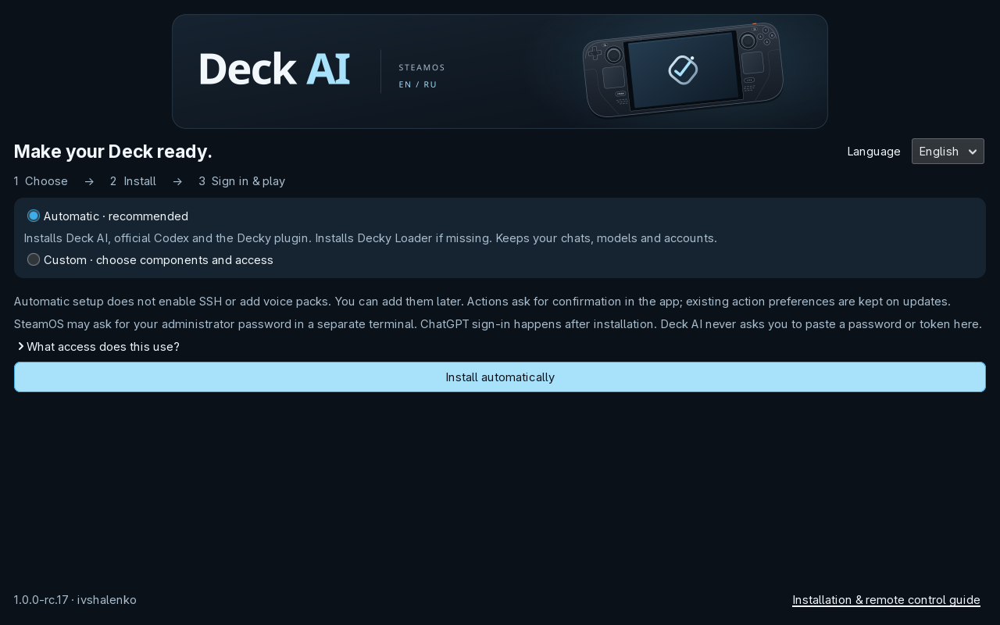

# Deck AI visual identity

The approved Steam Deck illustration defines the visual style: midnight blue surfaces, an ice-blue accent, silver controls and a restrained glow. English is the default; Russian has matching artwork.

| Role | Color |
| --- | --- |
| Background | `#0b1119` |
| Surface | `#162330` |
| Accent | `#a8e1fa` |
| Main text | `#f1f7fb` |
| Secondary text | `#a8bdce` |
| Border | `#304252` |
| Silver | `#dff5ff` → `#718ba1` |

- [English cover](brand/hero.svg) · [Russian cover](brand/hero-ru.svg)
- [Installer banner](brand/installer.svg)
- [Remote-control diagram](brand/remote.svg) · [Russian diagram](brand/remote-ru.svg)
- [Social/link cover, 1200 × 630](brand/social.png)
- [Application icon source](../icon.svg)
- [Shared Steam Deck master](brand/steam-deck.svg)

`python3 scripts/build-brand.py` regenerates the SVG artwork from the shared handheld master. Render `icon.svg` at 512 × 512 with a transparent outer background, then use the same PNG for `deck-ai.png` and `decky/deck-ai.png`. Render `docs/brand/social.svg` at 1200 × 630 for the social PNG. Preserve the vector proportions and control placement. The SVGs contain no remote assets or external fonts.

Screenshots remain actual captures. Historical Russian and English demonstration archives keep their original pixels and version labels. New interface artwork is shipped with rc.17; earlier screenshots document the versions in which they were captured.

## Current native installer captures

[Custom setup in English](media/en/branding/installer-custom.png) · [Custom setup in Russian](media/ru/branding/installer-custom.png). These are real GTK windows captured on the developer Steam Deck with a temporary profile. Installation was not started in this visual preview; the earlier installation test remains documented in [the installer guide](INSTALLER.md).
