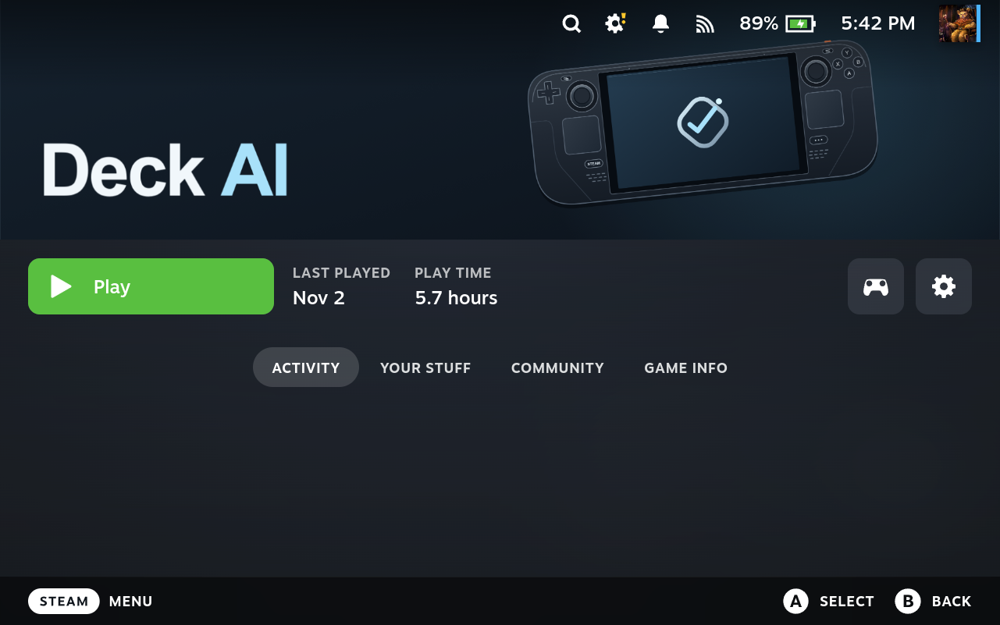
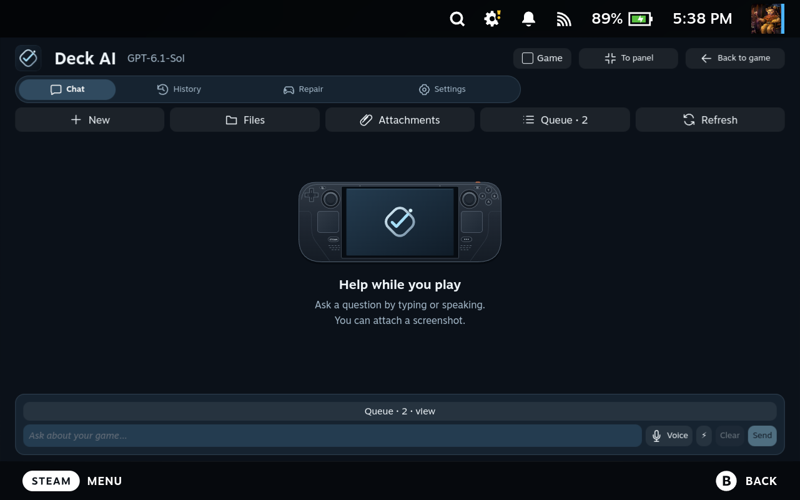
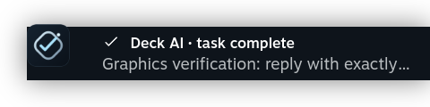

# One look in Gaming Mode and the Steam library

Deck AI uses the cover's midnight blue, ice-blue accent, accurate handheld illustration and silver logo throughout its default Ocean theme. Other selected color themes remain available. Tabs and controls use a matching outline icon set; the empty chat, plugin heading and real Steam notifications carry the project artwork.

## Add or refresh the Steam library entry

1. Install the full Deck AI package, or update to rc.18. The desktop companion provides the Gaming Mode launcher.
2. Open **(…) → Decky → Deck AI → Settings**.
3. Find **Deck AI in your Steam library** and press **Add or refresh Deck AI in Steam**.
4. Choose **Open in library** to see the result. Steam does not need a restart.

The button adds the shortcut if missing. For an existing shortcut, its name and executable must identify the managed Deck AI launcher. Duplicate or unrelated shortcuts named Deck AI are preserved and reported. Other games keep their existing artwork.

Four library images are installed together, while the shortcut icon is assigned separately through Steam's native API. The vertical cover has one title and a restrained **CHAT / FIX / CONTROL** footer, with no repeated lower logomark.

## Restore your previous artwork

Press **Restore previous artwork** in the same card. Deck AI saves the previous custom images, shortcut-icon path and logo placement before applying its own set. Restore verifies the backup and the result. If you replace artwork independently afterward, Deck AI preserves that newer change and reports the conflict. Reapplying the same set does not replace its backup.

Backups are under `~/.local/state/deck-voice/library-artwork` on legacy installations, or the active Deck AI state directory on a new installation. Chats, accounts, models, launch options and controller choices are outside the artwork operation. Removing the desktop companion does not remove a Steam library shortcut; remove it through Steam if you no longer need it.

## Artwork files

The release's **steam-artwork.zip** includes the ready-to-use PNG set for manual customization. The source vectors are in [the gaming artwork folder](brand/gaming). The dimensions follow [Steamworks library-asset guidance](https://partner.steamgames.com/doc/store/assets/libraryassets).

| File | Size | Use |
| --- | --- | --- |
| `capsule.png` | 600 × 900 | Vertical library tile |
| `header.png` | 920 × 430 | Wide library tile |
| `hero.png` | 3840 × 1240 | Details-page background, with room for Steam's title overlay |
| `logo.png` | 1280 × 360, transparent | Title over the hero |
| `icon.png` | 512 × 512 | Shortcut icon |

These are actual English captures on the developer Steam Deck from the rc.18 candidate. The device retains its existing queue history. The notification follows a real no-tools Codex request, and clicking it opens the correct conversation. Earlier galleries retain their original pixels and version labels.
