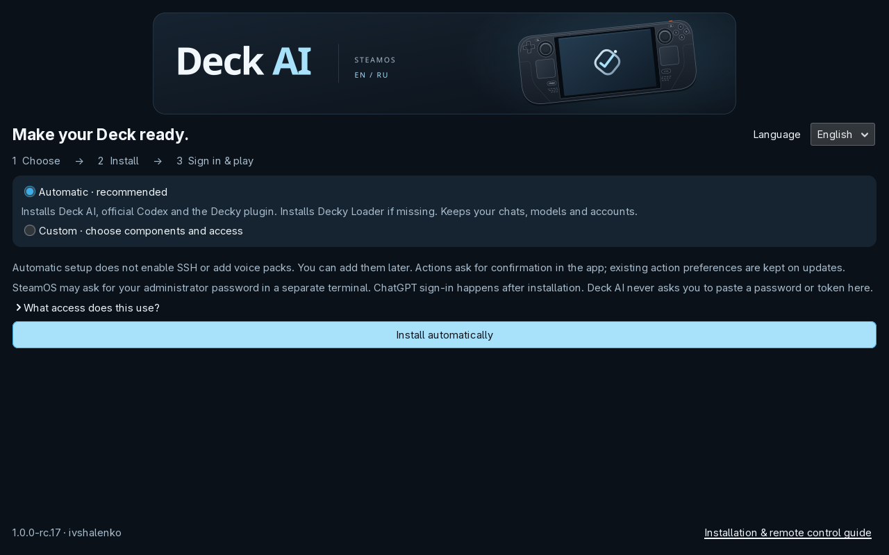
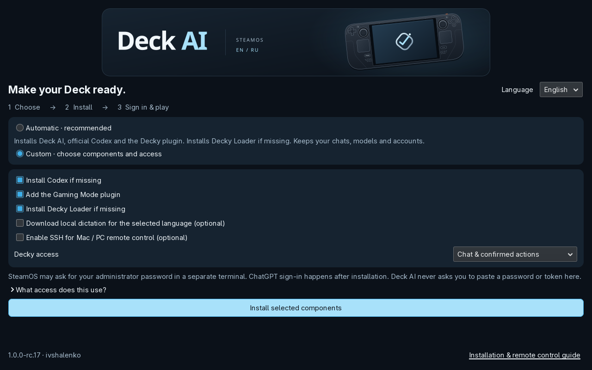
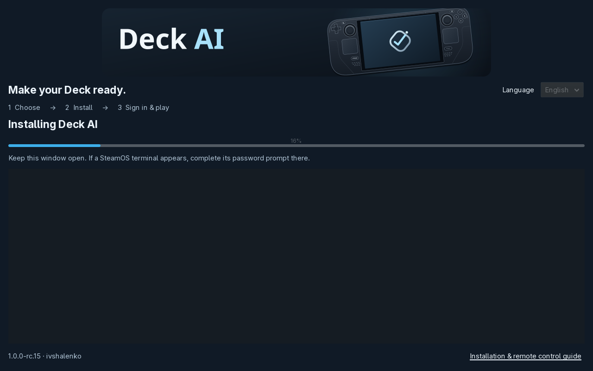
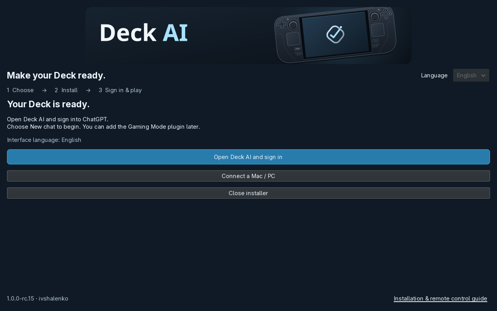
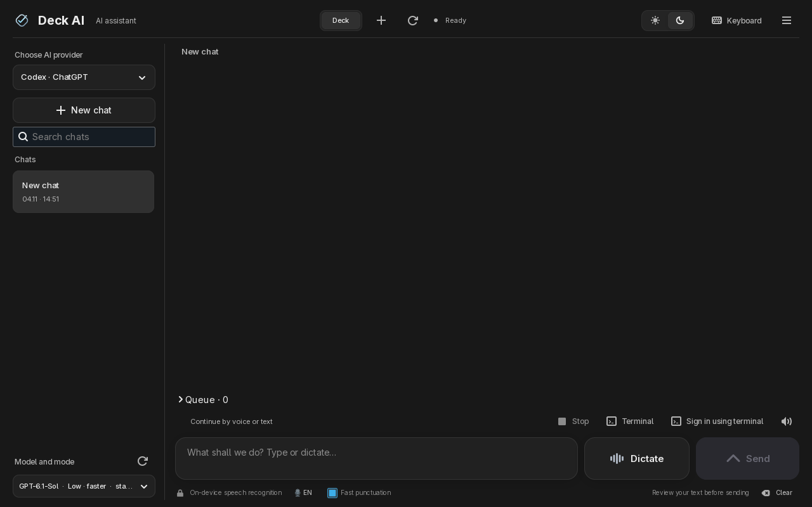

# An illustrated setup, in your language

[Download Install-Deck-AI.desktop](https://github.com/ivshalenko/codex-steamdeck/releases/download/v1.0.0-rc.21/Install-Deck-AI.desktop) · [Full installation guide](QUICKSTART.md) · [Russian guide](QUICKSTART.ru.md)

The launcher opens a graphical download window, checks the release checksum, then opens the full setup. It also comes inside the repository ZIP, so you do not need to build source code. SteamOS still requires you to trust a downloaded executable once.

If GitHub returns 504 before the file downloads, [save the alternate installer](https://raw.githubusercontent.com/ivshalenko/codex-steamdeck/main/Install-Deck-AI.desktop) with **Save link as → Install-Deck-AI.desktop**, then open it in Dolphin. If the browser displays code, save the link rather than copying the page. The rc.21 installer also recovers component downloads through the official GitHub asset API, validating the published release, asset origin, limits and SHA-256. Existing users who cannot update because of a 504 can run this installer once; later updates include the same recovery.

## Automatic setup

English is the default, including on a fresh profile with a Russian system locale. Automatic setup installs the app, missing official Codex and the Gaming Mode plugin. If Decky Loader is missing, its official installer runs in a visible terminal. An existing Loader is reused; your chats, accounts and models remain.

## Custom components and access

Choose which components to install. Local dictation downloads only the selected English or Russian pack. SSH is enabled only when selected; pairing still requires authorizing your own computer's public key. Decky can allow chat and confirmed actions or open saved history only. This is an application mode, not an operating-system sandbox. Desktop action permissions remain in the desktop app's own settings.

Automatic setup does not enable new SSH access or add voice packs. You can add these later. It does not turn off existing SSH or remove previously installed voice packs.

The two screenshots above show the rc.17 native installer, captured without starting installation in a temporary profile. The progress, completion and first-launch captures below document the earlier rc.15 installation test.

## Visible progress and a truthful result

The app's core WebSocket dependency comes from its packaged wheel. Codex and optional components need internet. Progress shows the current stage, with technical details underneath. Administrative tasks run in Konsole; enter the SteamOS password only there. A cancelled terminal, failed command or missing completion receipt does not display success. Return to the choices and retry.

After installation, the completion page opens Deck AI for account sign-in and offers computer pairing. Account sign-in remains personal; the installer does not grant itself access to an AI account or collect passwords.

## First launch uses your selection

Choose Russian in the installer and both the desktop companion and Decky use Russian. Choose English and they use English. Menu language does not translate existing chats, file contents or command output. A prior dictation language is kept unless you explicitly install a new selected-language pack.

[Earlier English installer gallery (rc.15)](https://github.com/ivshalenko/codex-steamdeck/releases/download/v1.0.0-rc.15/deck-ai-1.0.0-rc.15-installer-media.zip) · [Capture manifest](media/en/installer/manifest.json)

These are real GTK captures on Steam Deck. The fresh-profile check installed the desktop app and pinned official Codex in a temporary HOME, then updated with Russian selected and checked both first launches. It did not replace the user's Decky Loader or enable SSH for that test. Missing-Loader installation and administrator failures have isolated regression coverage; a second clean physical Deck remains an independent check. [Verification details](RELEASE-rc.15.md).
