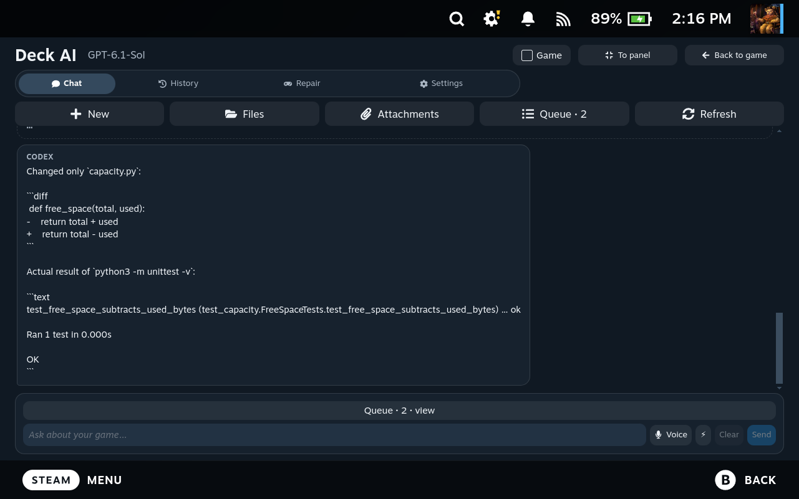

# Deck AI in English

[Installation](QUICKSTART.md) · [Remote control](REMOTE-CONTROL.md) · [Russian video archive](MEDIA.md)

**22 real captures from rc.14, recorded on Steam Deck on 4 November 2026.** Steam, the plugin, the installer and the desktop companion are in English. The conversations are new English demonstrations, not translations over old screenshots.

[Download the English gallery ZIP](https://github.com/ivshalenko/codex-steamdeck/releases/download/v1.0.0-rc.14/deck-ai-1.0.0-rc.14-english-media.zip) · [Capture manifest](media/en/manifest.json)

## Screenshot index

| Scene | What the actual capture shows |
| --- | --- |
| [01-bloodborne-setup.png](media/en/screenshots/01-bloodborne-setup.png) | A new English conversation about planning Bloodborne emulation with user-supplied game files; no installation is claimed. |
| [02-bloodborne-error.png](media/en/screenshots/02-bloodborne-error.png) | A controlled example Vulkan error report and a real English diagnostic reply. The error report is simulated. |
| [03-zelda-botw.png](media/en/screenshots/03-zelda-botw.png) | A new English request for a Breath of the Wild setup checklist using user-supplied files; no game was downloaded. |
| [04-zelda-totk.png](media/en/screenshots/04-zelda-totk.png) | A new English Tears of the Kingdom planning conversation with performance limitations; no installation is claimed. |
| [05-keyboard-troubleshooting.png](media/en/screenshots/05-keyboard-troubleshooting.png) | A simulated on-screen keyboard problem and a real English troubleshooting reply. |
| [06-fullscreen-chat.png](media/en/screenshots/06-fullscreen-chat.png) | The actual English full-screen chat with a new empty conversation. |
| [07-appearance-settings.png](media/en/screenshots/07-appearance-settings.png) | English appearance controls: themes, message style, density and layout. |
| [08-compact-panel.png](media/en/screenshots/08-compact-panel.png) | The actual compact Decky panel in English. |
| [09-installation-wizard.png](media/en/screenshots/09-installation-wizard.png) | The real first-run installation wizard in English. No installation options were executed for this capture. |
| [10-owned-game-files.png](media/en/screenshots/10-owned-game-files.png) | A new English conversation explaining bring-your-own-file requirements and the limits of the plugin. |
| [11-completion-notification.png](media/en/screenshots/11-completion-notification.png) | An actual English Steam toast emitted when the demonstration task completed in the background. |
| [12-notification-result.png](media/en/screenshots/12-notification-result.png) | Clicking the actual completion notification opens the correct English conversation. |
| [14-mac-controls-deck.png](media/en/screenshots/14-mac-controls-deck.png) | A real conversation created from the Mac using deck-remote, running on the Steam Deck; no commands were executed by the model. |
| [15-bug-fix-result.png](media/en/screenshots/15-bug-fix-result.png) | The actual desktop conversation after the agent repaired a small demonstration project; the unchanged unit test passes. |
| [16-failing-test.png](media/en/screenshots/16-failing-test.png) | The actual desktop conversation showing the controlled failing free-space test. |
| [17-diff-and-passing-test.png](media/en/screenshots/17-diff-and-passing-test.png) | Real desktop history with the subtraction fix and successful unit test. |
| [18-bug-fix-request.png](media/en/screenshots/18-bug-fix-request.png) | A real English request to fix the controlled example while keeping its test unchanged. |
| [20-live-fix-result.png](media/en/screenshots/20-live-fix-result.png) | The actual English result of the correction; the unchanged test passes. |
| [25-action-confirmation.png](media/en/screenshots/25-action-confirmation.png) | A real approval request for the reviewed one-line correction in the controlled demonstration. |
| [26-second-confirmation.png](media/en/screenshots/26-second-confirmation.png) | The second confirmation is visible; the demonstration file is still unchanged. |
| [27-confirmed-result.png](media/en/screenshots/27-confirmed-result.png) | The real result after the two-step approval and a verified passing test. |
| [28-language-settings.png](media/en/screenshots/28-language-settings.png) | The real English/Russian interface selector and separate speech-language setting. |

## Demonstration details

The Bloodborne, Zelda and keyboard conversations use new English prompts and real English Codex replies. Error reports in those support examples are explicitly simulated. No game was downloaded, installed or launched for these captures. Deck AI supplies no game files, keys or firmware.

The free-space example is a separate demonstration project. Its original test failed because `free_space(1000, 250)` returned `1250`. Codex changed `total + used` to `total - used`; the unchanged test then passed. The action was approved through the real two-step UI, after reviewing the exact proposed patch. The desktop images show the saved history of that same real task.

The Mac example was created with the installed `deck-remote` command and answered by Codex on Deck. The notification was emitted with the panel closed; clicking it opened the correct English conversation.

All interface captures were checked for visible Cyrillic text and blank frames. Some controls or long toast previews naturally truncate at the device viewport. Personal account settings and unrelated conversation contents are outside the selected captures.

## Russian originals for the video

The [original 21 screenshots and 7 videos](MEDIA.md) remain available with their original versions and Russian conversations. Their PNG files were preserved byte for byte. Use those for the Russian YouTube edit; use this English set for international project pages.
