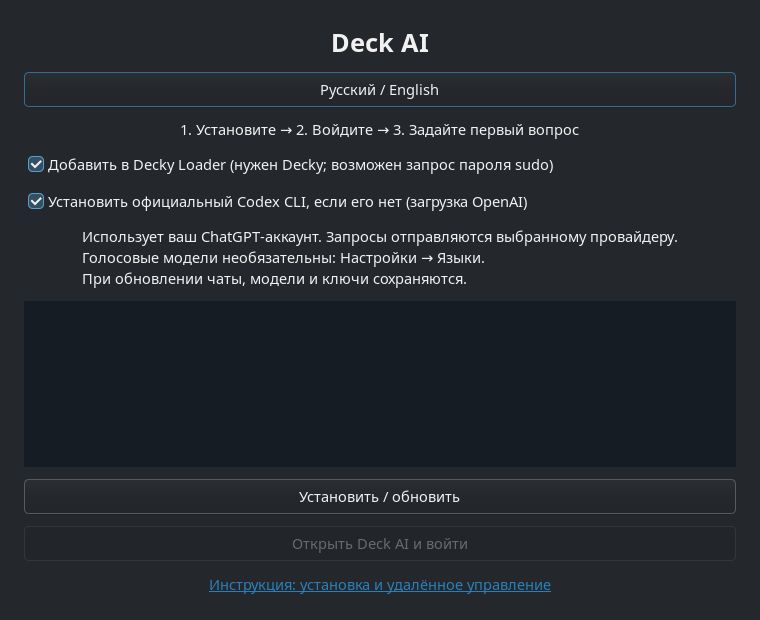
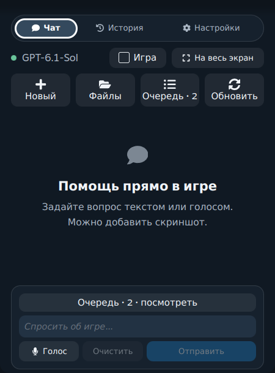
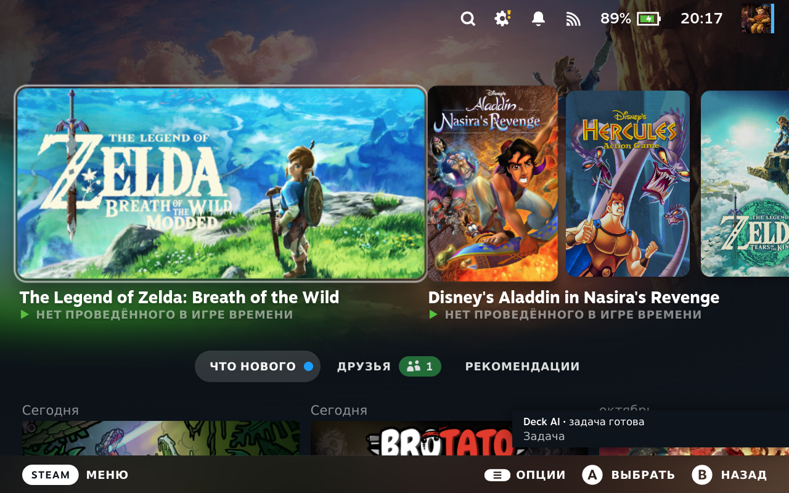

# Deck AI: первый запуск

## Steam Deck — установка без сборки

1. Нужны интернет, свободные 800 МБ и доступ к своему ChatGPT. Для голоса потребуется дополнительное место. Перейдите в **Desktop Mode**: Steam → Power → Switch to Desktop.
2. Откройте [последний релиз](https://github.com/ivshalenko/codex-steamdeck/releases/tag/v1.0.0-rc.12). Скачайте **Install-Deck-AI.desktop** именно на Steam Deck.
3. В Dolphin откройте Downloads. Нажмите на установщик. Если система спрашивает, разрешите выполнение: **Execute / Trust and launch**. Если файл открылся как текст: Properties → Permissions → **Is executable**, затем откройте снова. Это обычное разрешение на запуск скачанного приложения.
4. Мастер покажет этапы установки. Codex загружается официальным установщиком OpenAI с GitHub, закреплённым на версии 0.166.0 и проверяемым по SHA-256. Оставьте «Установить Codex», если его ещё нет. Для плагина нужен [Decky Loader](https://decky.xyz); мастер не устанавливает Decky за вас. Если Decky установлен, отметьте его пункт. Не закрывайте мастер до сообщения «Готово».
5. При запросе sudo в отдельном терминале введите **свой пароль SteamOS**. Если он ещё не задан: откройте Konsole и выполните `passwd`. При вводе пароля символы не отображаются — это нормально. Приложение не получает и не хранит пароль.
6. Нажмите **Открыть Deck AI и войти**. Войдите через ChatGPT в браузере. При входе по коду откройте показанный адрес на телефоне/компьютере и введите код только на официальной странице OpenAI.
7. Вернитесь в Gaming Mode. Откройте **(…) → Decky → Deck AI**. В настройках выберите Codex. Нажмите **Новый чат**, напишите «Покажи свободное место на Steam Deck» и отправьте.

Нужен ручной способ: скачайте **steamdeck.tar.gz**, распакуйте, откройте Konsole в полученной папке и выполните `python3 scripts/setup.py`. Для установки без мастера: `bash install.sh --decky`. Этот способ не устанавливает Codex автоматически; сначала установите [официальный CLI](https://github.com/openai/codex#quickstart).

## Если установлен только ZIP Decky

Включите Developer Mode в Decky → Settings → Developer → **Install Plugin from ZIP** и выберите **decky.zip** из релиза. У пакета есть собственный Python-код и WebSocket-библиотека: настольное приложение для текстового чата не требуется. **Codex CLI и вход ChatGPT всё равно нужны на Deck.** Установите их мастером выше. Плагин отсутствует в официальном каталоге, пока модераторы не одобрят публикацию; не ищите его там как уже опубликованный.

## Каждый день

- **Чат**: вопросы, команды и прикреплённые изображения. Сначала убедитесь, что выбрано нужное устройство.
- **История**: выберите диалог и продолжайте его. Не отправляйте запрос повторно, пока предыдущий остаётся в очереди: сначала откройте его состояние.
- **Полный экран**: кнопка разворачивания; обратно в панель или к игре — кнопками в заголовке.
- **Подтверждения**: прочитайте команду/изменения перед разрешением. Для знакомства оставьте автоматическое подтверждение выключенным. «Только чтение» блокирует изменения через интерфейс.
- **Уведомления**: включите в настройках. После завершения задачи при закрытой панели появится уведомление Decky; нажатие открывает нужный диалог. Не завершайте Steam или Decky во время работы. Во сне задачи не выполняются на выключенном/уснувшем устройстве.
- **Голос**: в настольном приложении откройте Настройки → Языки. Выберите язык и загрузите пакет, дождитесь готовности. Распознавание локальное; сам текст запроса и вложения уходят выбранному облачному провайдеру. Другие провайдеры и озвучка необязательны.
- **Скриншоты / видео**: выберите скриншот Steam или запись. Из видео прикладываются до четырёх кадров; это не анализ всего видео. Игровые файлы и покупки приложение не предоставляет.

[Настроить Mac / Windows / Linux и удалённое управление →](REMOTE-CONTROL.md)

## Что делать при ошибке

| На экране | Что сделать |
|---|---|
| Codex CLI не установлен | Desktop Mode → Install Deck AI → установить Codex. Затем войти в ChatGPT. |
| Вход не выполнен | Настройки → Аккаунт → Войти через ChatGPT; завершить вход в браузере. |
| Чат загружается после сна | Подождать восстановления сети → Повторить подключение. Сохранённая история остаётся на экране с предупреждением, пока не придут свежие данные. Черновик сохраняется. |
| Задача с ошибкой в очереди | Открыть её чат и проверить результат до повторной отправки. Старые ошибки не удаляются автоматически. |
| Голос недоступен | Загрузить языковой пакет, проверить микрофон, отключить speaker monitor. Для текста голос не нужен. |
| API-ключ не сохраняется | Разблокировать KWallet в Desktop Mode. Не вставлять ключи в сообщения или issue. |
| Decky показывает ошибку | Настройки Deck AI → Диагностика. Обновить ZIP из релиза, перезапустить Decky. Приложить версию и текст ошибки в [issue](https://github.com/ivshalenko/codex-steamdeck/issues). |

Обновление повторно запускает тот же мастер. Чаты, модели, аккаунты и SSH-ключи сохраняются. Предыдущая папка плагина сохраняется рядом как `.Codex-backup-…`. Не устанавливайте две копии Deck AI в разные папки плагинов одновременно. Для удаления настольного приложения используйте `~/.local/bin/deck-ai-uninstall`; пользовательские данные останутся. ZIP удаляется средствами Decky.

## English

Switch to Desktop Mode. Download **Install-Deck-AI.desktop** from [Releases](https://github.com/ivshalenko/codex-steamdeck/releases/tag/v1.0.0-rc.12), mark it executable/trusted in Dolphin if prompted, and open it. The wizard installs the app, offers the official Codex CLI if missing, and optionally installs the Decky plugin (Decky must already be installed). A terminal shows any SteamOS sudo password prompt. Click **Open Deck AI**, sign into ChatGPT, return to Gaming Mode, then **(…) → Decky → Deck AI → New chat**. Voice is optional and configured later in the desktop app's language settings. The ZIP plugin bundles its own core runtime, but still needs Codex installed and signed in. Follow the [remote-control guide](REMOTE-CONTROL.md) for computer pairing. This is a release candidate; suspend/resume, independent fresh-device installation and physical controller testing are still listed in the release report.
