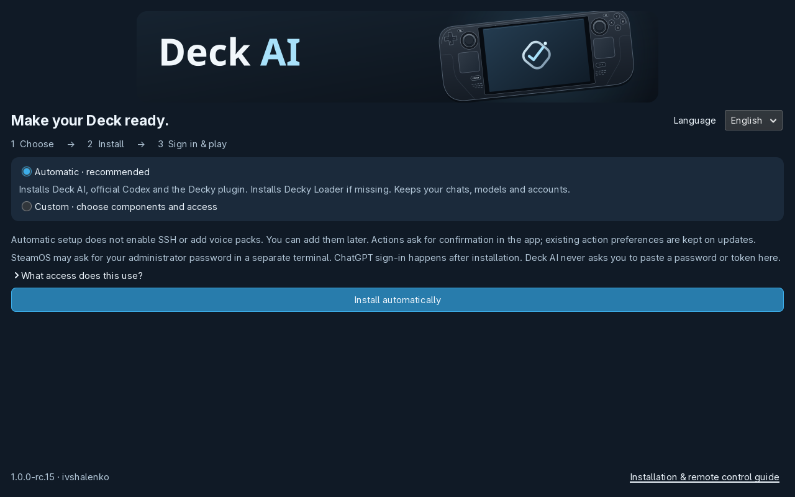
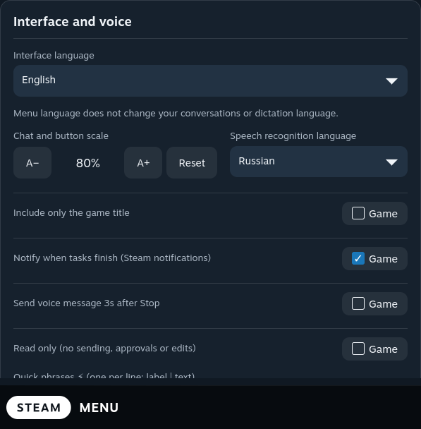
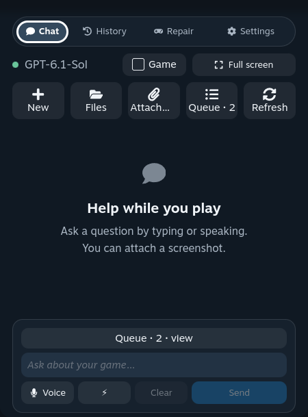
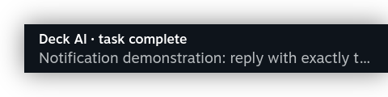

# Deck AI: your first conversation

[Project](../README.md) · [Russian guide](QUICKSTART.ru.md) · [Connect a computer](REMOTE-CONTROL.md)

## Install on Steam Deck

1. Have internet access, at least **800 MB free** and your own ChatGPT account. Voice packs need extra space. Switch to **Desktop Mode**: Steam → Power → Switch to Desktop.
2. Download **[Install-Deck-AI.desktop](https://github.com/ivshalenko/codex-steamdeck/releases/download/v1.0.0-rc.21/Install-Deck-AI.desktop)** onto Deck. If you downloaded the project ZIP instead, extract it and open the included file with that name.
3. Open it in Dolphin. Confirm **Execute / Trust and launch** if asked. If it opens as text, use Properties → Permissions → **Is executable** and open it again. SteamOS requires this first authorization; the app cannot grant trust to itself.
4. The illustrated download window verifies the release, then opens the full installer. It starts in **English** regardless of the SteamOS language. You can choose **Russian** in either window; that choice is passed to the full installer and saved for Deck AI.
5. Choose **Automatic** for Deck AI, missing official Codex and the Gaming Mode plugin. If Decky Loader is absent, the selected automatic plan runs its official installer in a visible terminal. Existing Decky installations are reused.
6. Or choose **Custom** to select Codex, the Gaming Mode plugin, permission to install missing Decky Loader, an optional dictation pack, optional SSH remote access, and Decky's action mode. Unchecked components are skipped. SSH is not enabled and voice packs are not downloaded by Automatic setup. Existing settings remain intact.
7. Click **Install**. Follow the progress. Enter your SteamOS administrator password only in the separate terminal if asked. If no password exists, open Konsole and run `passwd`, then retry. Password characters are hidden; Deck AI does not collect or store the password.
8. After **Installation complete**, choose **Open Deck AI and sign in**. Finish ChatGPT sign-in in the browser. For a device code, use only the official OpenAI page. Account sign-in is a personal step and is not automatic.
9. Return to **Gaming Mode → (…) → Decky → Deck AI → New chat**. Try “Show the free space on my Steam Deck.” Review any requested action before allowing it.

[See Custom, progress and completion screens →](INSTALLER.md)

Codex uses the pinned official OpenAI installer for version 0.166.0, checked by SHA-256. The optional missing-Decky step uses a checksum-pinned official Decky installer, which obtains the upstream stable Loader. It changes system services and can require your administrator password. [Official Decky installation](https://github.com/SteamDeckHomebrew/decky-loader#-installation).

Manual source alternative: extract **steamdeck.tar.gz** and run `python3 scripts/setup.py` (or `python3 scripts/setup.py --language ru`). `bash install.sh --decky` is the lower-level installation route and does not automatically install Codex or missing Decky Loader.

## Choose your language

In Decky, open **Settings → Interface and voice → Interface language → English**. Russian is also available. Both Decky views share the saved preference with the desktop companion. Menu language does not translate existing conversations or change dictation language. Start a **New chat** and write in English for a new English conversation.

The installer defaults to English and has its own language selector. Its choice is saved for both the desktop app and Decky. To make Steam's surrounding menus English too, change Steam's language in **Steam → Settings → Interface** and apply any requested restart. This is a separate Steam setting.

## Decky ZIP only

In Decky settings, enable Developer Mode, then open Developer → **Install Plugin from ZIP** and select the release's **decky.zip**. The ZIP includes its Python runtime and WebSocket dependency. Text chat does not require the desktop companion, but **Codex CLI and ChatGPT sign-in are still required on Deck**. The wizard above can set them up.

Deck AI is manually distributed through GitHub Releases. It is [not in the official Decky store](DECKY-SUBMISSION.md). Avoid installing duplicate copies under different plugin folders.

## Daily use

- **Chat:** ask a question, give a task or attach an image. Check which device is selected before asking for file changes.
- **History:** continue an existing conversation. If a task is waiting, inspect its queue entry before sending the same request again.
- **Full screen:** expand from the compact panel; use **To panel** or **Back to game** in the header to return.
- **Actions:** read the proposed command or change. Keep auto-approval off while getting familiar with the app. Read-only mode blocks changes through this interface.
- **Notifications:** enable completion notifications in Settings. With the panel closed, a Steam toast opens the corresponding chat. Keep Steam and Decky running; a sleeping device cannot perform tasks.
- **Voice:** add an optional language pack in the desktop app's language settings and wait until it is ready. Dictation is local; the resulting prompt goes to your chosen cloud provider. Voice is not required for text chat.
- **Attachments:** choose Steam screenshots or a recording. A recording contributes up to four sampled frames, within a five-image limit per message. It is not full video analysis. Deck AI supplies no game files, firmware, keys or purchases.

[Connect your Mac, Windows or Linux computer →](REMOTE-CONTROL.md)

## Troubleshooting

| What you see | What to try |
| --- | --- |
| Codex CLI missing | Run the installer in Desktop Mode with the Codex option, then sign in with ChatGPT. |
| Not signed in | Open Deck AI's account settings, choose ChatGPT sign-in and finish in the browser. |
| Slow reconnect after sleep | Let the network recover, then reconnect. Saved history can remain visible with a warning until fresh data arrives. Your draft is preserved. |
| A failed task in the queue | Open its conversation and check the result before retrying. Old failures are not silently deleted. |
| Voice unavailable | Download its language pack, check the microphone and avoid recording speaker-monitor output. Text chat remains usable. |
| API key will not save | Unlock KWallet in Desktop Mode. Do not paste API keys into messages or GitHub issues. |
| Decky error | Open Deck AI's Diagnostics. Update the plugin ZIP and restart Decky if needed. Report the version and error text in an [issue](https://github.com/ivshalenko/codex-steamdeck/issues). |

Starting with rc.16, open **Deck AI → Settings → Deck AI updates** to check manually or install a compatible published release with one click. Automatic checks run once a week. [Update and recovery guide](UPDATES.md). The same wizard remains available for installation or repair. Chats, voice models, accounts and SSH keys are retained. The installer keeps the previous plugin folder beside it as `.Codex-backup-…`. Use `~/.local/bin/deck-ai-uninstall` to remove managed desktop files while retaining user data; remove the ZIP plugin through Decky.

This is a release candidate. Independent clean-device installation, suspend during an active task and physical controller checks remain outstanding. See the [release checks](RELEASE-rc.15.md).
