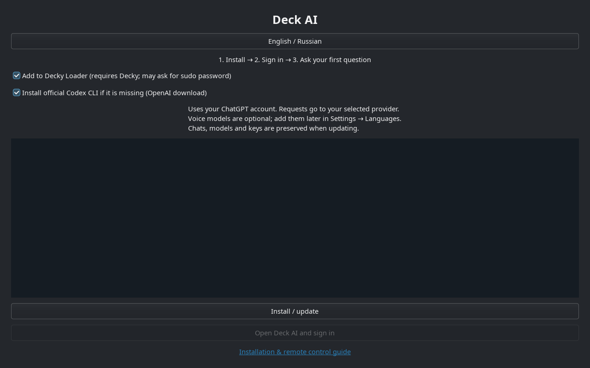

# Deck AI: your first conversation

[Project](../README.md) · [Russian guide](QUICKSTART.ru.md) · [Connect a computer](REMOTE-CONTROL.md)

## Install on Steam Deck

1. Have internet access, at least **800 MB free**, and your own ChatGPT account. Voice packs need extra space and are optional. Switch to **Desktop Mode**: Steam → Power → Switch to Desktop.
2. Open the [rc.14 release](https://github.com/ivshalenko/codex-steamdeck/releases/tag/v1.0.0-rc.14). Download **Install-Deck-AI.desktop** onto the Deck.
3. In Dolphin, open Downloads and launch the installer. If asked, choose **Execute / Trust and launch**. If it opens as text, use Properties → Permissions → **Is executable**, then open it again.
4. Follow the wizard. Keep **Install official Codex CLI if it is missing** selected when needed. The official OpenAI installer is pinned to Codex 0.166.0 and checked by SHA-256. For Gaming Mode, install [Decky Loader](https://decky.xyz) first, then select the Decky option. This wizard does not install Decky itself.
5. If a terminal asks for sudo, enter your **SteamOS password there**. To create one, open Konsole and run `passwd`. Password characters are not displayed while typing. Deck AI does not store this password.
6. Wait for **Ready**, then choose **Open Deck AI and sign in**. Complete ChatGPT sign-in in the browser. For device-code sign-in, enter the displayed code only on the official OpenAI page.
7. Return to **Gaming Mode → (…) → Decky → Deck AI**. Select Codex in Settings, then **New chat**. Try: “Show the free space on my Steam Deck.” Read any proposed action before approving it.

Manual alternative: download the release's **steamdeck.tar.gz**, extract it, open Konsole in the extracted folder and run `python3 scripts/setup.py`. `bash install.sh --decky` installs without the wizard but does not automatically install Codex; install the [official CLI](https://github.com/openai/codex#quickstart) separately in that case.

## Choose your language

In Decky, open **Settings → Interface and voice → Interface language → English**. Russian is also available. Both Decky views share the saved preference with the desktop companion. Menu language does not translate existing conversations or change dictation language. Start a **New chat** and write in English for a new English conversation.

The wizard selects its initial language from SteamOS and has its own English/Russian button. To make Steam's surrounding menus English too, change Steam's language in **Steam → Settings → Interface** and apply any requested restart. This is a separate Steam setting.

## Decky ZIP only

In Decky settings, enable Developer Mode, then open Developer → **Install Plugin from ZIP** and select the release's **decky.zip**. The ZIP includes its Python runtime and WebSocket dependency. Text chat does not require the desktop companion, but **Codex CLI and ChatGPT sign-in are still required on Deck**. The wizard above can set them up.

Deck AI is manually distributed through GitHub Releases. It is [not in the official Decky store](DECKY-SUBMISSION.md). Avoid installing duplicate copies under different plugin folders.

## Daily use

- **Chat:** ask a question, give a task or attach an image. Check which device is selected before asking for file changes.
- **History:** continue an existing conversation. If a task is waiting, inspect its queue entry before sending the same request again.
- **Full screen:** expand from the compact panel; use **To panel** or **Back to game** in the header to return.
- **Actions:** read the proposed command or change. Keep auto-approval off while getting familiar with the app. Read-only mode blocks changes through this interface.
- **Notifications:** enable completion notifications in Settings. With the panel closed, a Steam toast opens the corresponding chat. Keep Steam and Decky running; a sleeping device cannot perform tasks.
- **Voice:** add an optional language pack in the desktop app's language settings and wait until it is ready. Dictation is local; the resulting prompt goes to your chosen cloud provider. Voice is not required for text chat.
- **Attachments:** choose Steam screenshots or a recording. A recording contributes up to four sampled frames, within a five-image limit per message. It is not full video analysis. Deck AI supplies no game files, firmware, keys or purchases.

[Connect your Mac, Windows or Linux computer →](REMOTE-CONTROL.md)

## Troubleshooting

| What you see | What to try |
| --- | --- |
| Codex CLI missing | Run the installer in Desktop Mode with the Codex option, then sign in with ChatGPT. |
| Not signed in | Open Deck AI's account settings, choose ChatGPT sign-in and finish in the browser. |
| Slow reconnect after sleep | Let the network recover, then reconnect. Saved history can remain visible with a warning until fresh data arrives. Your draft is preserved. |
| A failed task in the queue | Open its conversation and check the result before retrying. Old failures are not silently deleted. |
| Voice unavailable | Download its language pack, check the microphone and avoid recording speaker-monitor output. Text chat remains usable. |
| API key will not save | Unlock KWallet in Desktop Mode. Do not paste API keys into messages or GitHub issues. |
| Decky error | Open Deck AI's Diagnostics. Update the plugin ZIP and restart Decky if needed. Report the version and error text in an [issue](https://github.com/ivshalenko/codex-steamdeck/issues). |

Run the same wizard to update. Chats, voice models, accounts and SSH keys are retained. The installer keeps the previous plugin folder beside it as `.Codex-backup-…`. Use `~/.local/bin/deck-ai-uninstall` to remove managed desktop files while retaining user data; remove the ZIP plugin through Decky.

This is a release candidate. Independent clean-device installation, suspend during an active task and physical controller checks remain outstanding. See the [release checks](RELEASE-rc.14.md).
