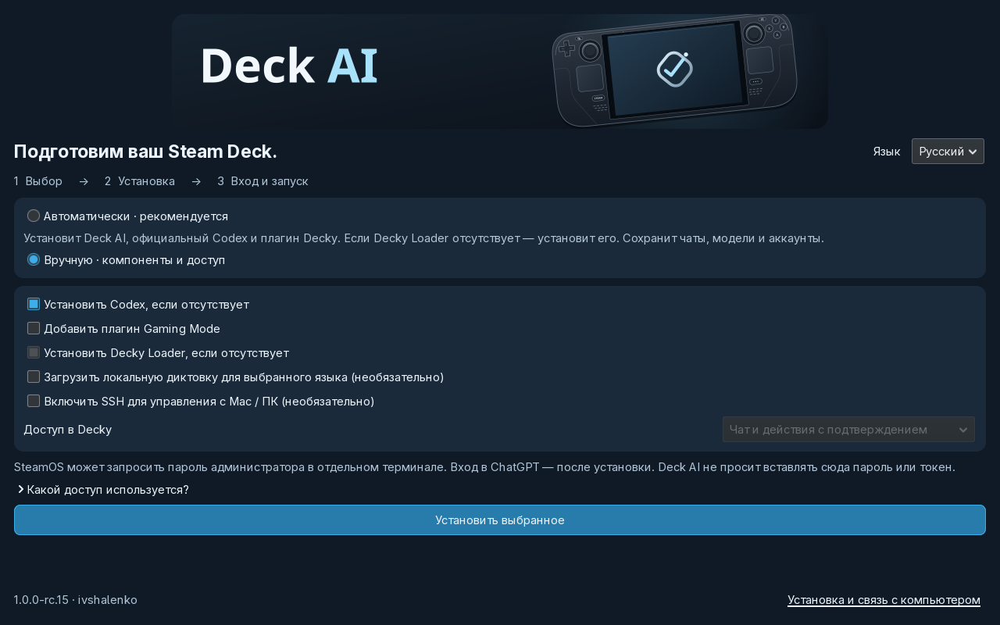
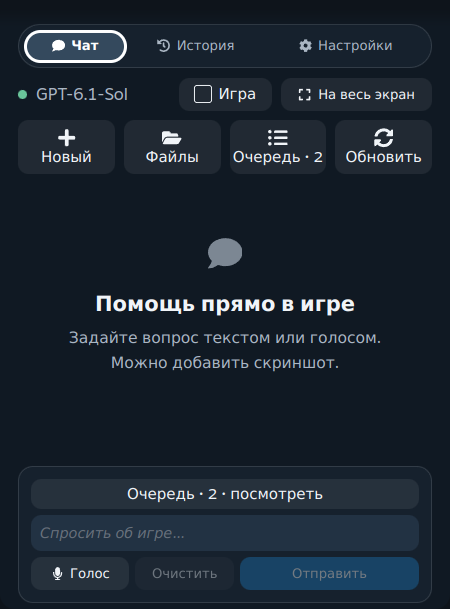
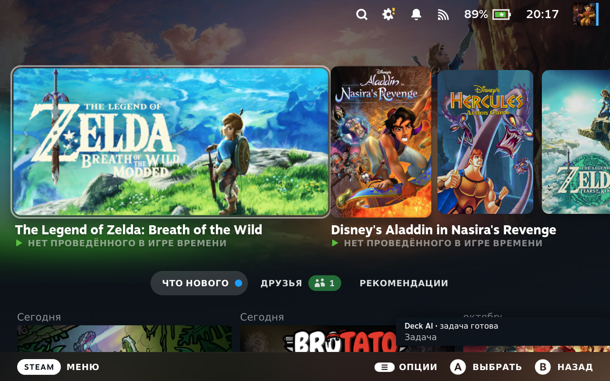

# Deck AI: первый запуск

## Steam Deck — графическая установка

1. Перейдите в Desktop Mode: Steam → Power → Switch to Desktop. Нужны интернет, минимум 2 ГБ и собственный аккаунт ChatGPT.
2. Откройте **[страницу загрузки](https://ivshalenko.github.io/codex-steamdeck/install/?lang=ru)** и нажмите **«Скачать для Steam Deck»**. Браузер скачает ZIP, а не откроет исходный код.
3. Откройте ZIP в Ark и нажмите **«Извлечь»**. В Dolphin откройте распакованную папку **Deck AI Setup**, затем **Install Deck AI** и подтвердите запуск SteamOS. Оставьте файлы вместе: архив приложения проверяется перед открытием мастера.
4. Откроется графический мастер. По умолчанию выбран **English**. Выберите **Русский** — этот язык сохранится для Deck AI и Decky.
5. **Автоматически**: приложение, отсутствующий официальный Codex и плагин Gaming Mode. Если Decky Loader отсутствует, мастер запустит его официальный установщик в видимом терминале. Уже установленный Decky используется повторно.
   Deck AI также добавится как стороннее приложение в библиотеку Steam с обложками, фоном, логотипом и значком. Если Steam ещё не готов, мастер покажет ожидающий шаг; он завершится автоматически при запуске Deck AI или панели Decky. В ручном режиме добавление в библиотеку можно отключить.
6. **Вручную**: выберите Codex, плагин, разрешение установить отсутствующий Decky Loader, голосовой пакет выбранного языка, SSH и режим действий в Decky. Автоматический режим не включает новый SSH и не скачивает голосовые пакеты. Существующие настройки сохраняются.
7. Нажмите «Установить». Если SteamOS запросит пароль администратора, введите его в отдельном терминале. Если пароль ещё не задан, выполните `passwd` в Konsole и повторите. Символы пароля скрыты; Deck AI его не получает.
8. После завершения нажмите «Открыть Deck AI и войти». Войдите в ChatGPT через браузер. Вход в личный аккаунт выполняется самостоятельно.
   На рабочем столе также появится ярлык **Deck AI** для обычного запуска приложения. Установщик учитывает папку «Рабочий стол»; повторные обновления не создают дубликаты.
9. Вернитесь в Gaming Mode → (…) → Decky → Deck AI → Новый чат. Настройки и меню уже будут на выбранном языке. Попробуйте «Покажи свободное место на Steam Deck» и прочитайте предложенное действие перед подтверждением.

В терминале вручную: распакуйте steamdeck.tar.gz, откройте Konsole в папке и выполните `python3 scripts/setup.py --language ru`. Команда `bash install.sh --decky` — упрощённый путь без мастера; она не устанавливает автоматически Codex и отсутствующий Decky Loader.

**Старая установка остановилась на 40% с ошибкой Codex / 504?** Закройте её и запустите свежий установщик rc.22 или новее. Он повторит загрузку официального Codex через GitHub API, проверит размер и SHA-256; официальный установщик OpenAI дополнительно проверит манифест. Переустанавливать SteamOS и удалять уже установленные настройки не нужно.

## Если установлен только ZIP Decky

Включите Developer Mode в Decky → Settings → Developer → **Install Plugin from ZIP** и выберите **decky.zip** из релиза. У пакета есть собственный Python-код и WebSocket-библиотека: настольное приложение для текстового чата не требуется. **Codex CLI и вход ChatGPT всё равно нужны на Deck.** Установите их мастером выше. Для Deck AI доступна ручная установка из GitHub Releases. [Официальный каталог отклонил заявку](DECKY-SUBMISSION.md).

## Каждый день

- **Чат**: вопросы, команды и прикреплённые изображения. Сначала убедитесь, что выбрано нужное устройство.
- **История**: выберите диалог и продолжайте его. Не отправляйте запрос повторно, пока предыдущий остаётся в очереди: сначала откройте его состояние.
- **Полный экран**: кнопка разворачивания; обратно в панель или к игре — кнопками в заголовке.
- **Подтверждения**: прочитайте команду/изменения перед разрешением. Для знакомства оставьте автоматическое подтверждение выключенным. «Только чтение» блокирует изменения через интерфейс.
- **Уведомления**: включите в настройках. После завершения задачи при закрытой панели появится уведомление Decky; нажатие открывает нужный диалог. Не завершайте Steam или Decky во время работы. Во сне задачи не выполняются на выключенном/уснувшем устройстве.
- **Голос**: в настольном приложении откройте Настройки → Языки. Выберите язык и загрузите пакет, дождитесь готовности. Распознавание локальное; сам текст запроса и вложения уходят выбранному облачному провайдеру. Другие провайдеры и озвучка необязательны.
- **Скриншоты / видео**. В чате нажмите **Вложения**, выберите скриншот Steam или запись. Из видео прикладываются до четырёх кадров. В одном сообщении помещается до пяти изображений. Если места осталось меньше, интерфейс покажет, сколько кадров добавлено. Игровые файлы и покупки приложение не предоставляет.

[Настроить Mac / Windows / Linux и удалённое управление →](REMOTE-CONTROL.ru.md)

## Что делать при ошибке

| На экране | Что сделать |
|---|---|
| Codex CLI не установлен | Desktop Mode → Install Deck AI → установить Codex. Затем войти в ChatGPT. |
| Вход не выполнен | Настройки → Аккаунт → Войти через ChatGPT; завершить вход в браузере. |
| Чат загружается после сна | Подождать восстановления сети → Повторить подключение. Сохранённая история остаётся на экране с предупреждением, пока не придут свежие данные. Черновик сохраняется. |
| Задача с ошибкой в очереди | Открыть её чат и проверить результат до повторной отправки. Старые ошибки не удаляются автоматически. |
| Голос недоступен | Загрузить языковой пакет, проверить микрофон, отключить speaker monitor. Для текста голос не нужен. |
| API-ключ не сохраняется | Разблокировать KWallet в Desktop Mode. Не вставлять ключи в сообщения или issue. |
| Decky показывает ошибку | Настройки Deck AI → Диагностика. Обновить ZIP из релиза, перезапустить Decky. Приложить версию и текст ошибки в [issue](https://github.com/ivshalenko/codex-steamdeck/issues). |

Начиная с rc.16, обновления доступны в Deck AI → Настройки → Обновления Deck AI. Автопроверка — раз в неделю; есть ручная проверка и установка одной кнопкой. Мастер остаётся доступен для установки и восстановления. Чаты, модели, аккаунты и SSH-ключи сохраняются. Предыдущая папка плагина сохраняется рядом как `.Codex-backup-…`. Не устанавливайте две копии Deck AI в разные папки плагинов одновременно. Для удаления настольного приложения используйте `~/.local/bin/deck-ai-uninstall`; пользовательские данные останутся. ZIP удаляется средствами Decky.

## English

Switch to Desktop Mode. Download **Install-Deck-AI.desktop** from [Releases](https://github.com/ivshalenko/codex-steamdeck/releases/tag/v1.0.0-rc.26), mark it executable/trusted in Dolphin if prompted, and open it. The wizard installs the app, offers the official Codex CLI if missing, and optionally installs the Decky plugin (Decky must already be installed). A terminal shows any SteamOS sudo password prompt. Click **Open Deck AI**, sign into ChatGPT, return to Gaming Mode, then **(…) → Decky → Deck AI → New chat**. Voice is optional and configured later in the desktop app's language settings. The ZIP plugin bundles its own core runtime, but still needs Codex installed and signed in. Follow the [remote-control guide](REMOTE-CONTROL.ru.md) for computer pairing. This is a release candidate; suspend/resume, independent fresh-device installation and physical controller testing are still listed in the release report.
