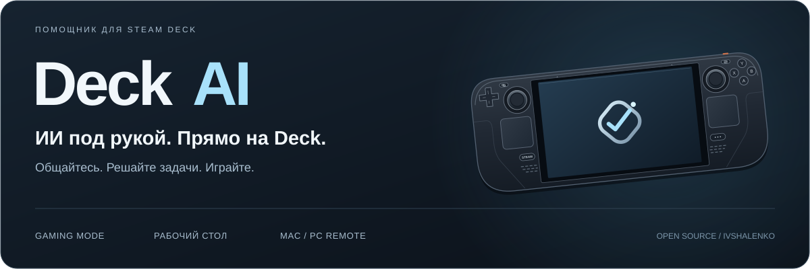
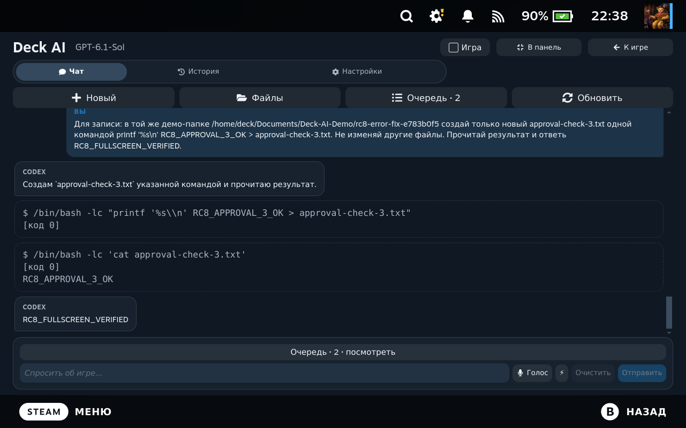
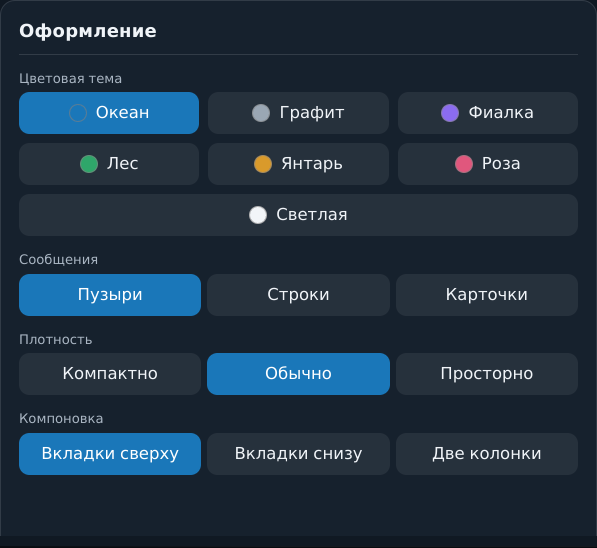
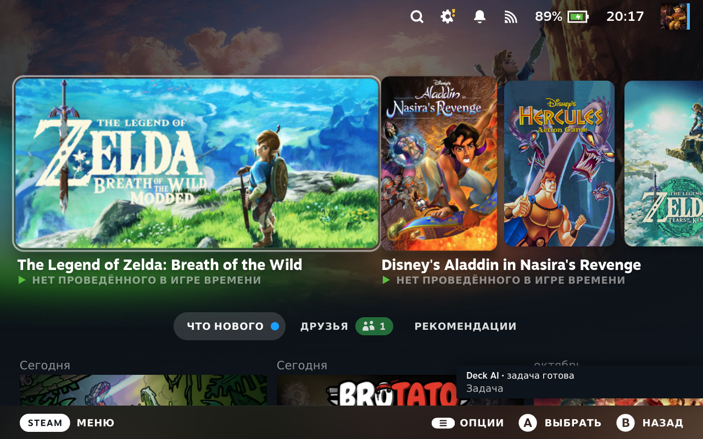
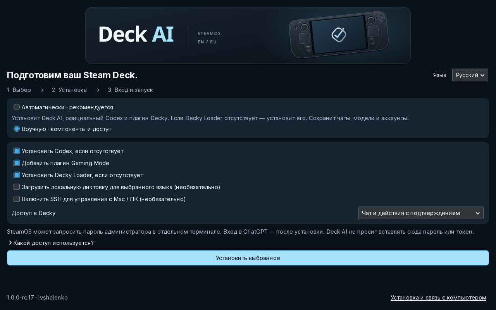
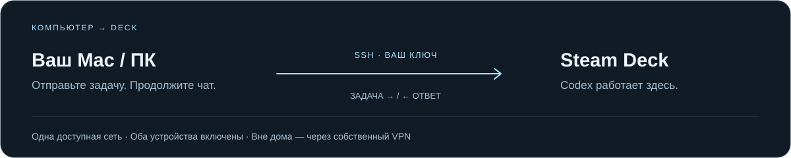

**Русский** · [English](../README.md)

[](https://github.com/ivshalenko/codex-steamdeck/actions/workflows/checks.yml) [](https://github.com/ivshalenko/codex-steamdeck/releases/tag/v1.0.0-rc.17) [](../LICENSE)

**Попросите о помощи, разберитесь с ошибкой запуска или отправьте задачу с Mac.** Deck AI добавляет Codex в меню быстрого доступа Steam Deck: полноэкранный чат, подтверждение действий, вложения и уведомления. В комплекте — настольное приложение и удалённое управление по SSH.

[](https://github.com/ivshalenko/codex-steamdeck/releases/download/v1.0.0-rc.17/Install-Deck-AI.desktop)

**[Установка](#установка-на-steam-deck)** · **[Демонстрация](#как-это-выглядит)** · **[Связь с Mac / ПК](#компьютер-как-пульт-steam-deck-как-исполнитель)** · **[Ответы на вопросы](#ответы-на-вопросы)** · **[Все инструкции](#куда-дальше)**

Бесплатный проект с открытым кодом. **Предварительный выпуск · ручная установка.** Для ИИ нужен собственный аккаунт: тариф, лимиты и стоимость запросов определяет провайдер. [Статус каталога Decky](DECKY-SUBMISSION.md).

## Три способа пользоваться

| В Gaming Mode | На рабочем столе | С компьютера |
| --- | --- | --- |
| **(…) → Decky → Deck AI**. Задайте вопрос, приложите скриншот, проверьте действие и возвращайтесь к игре. | GTK-приложение для длинных разговоров, входа в аккаунт, локальной диктовки и настройки языков. | Подключите Mac, Windows или Linux по SSH. Создавайте задачи на Deck и продолжайте тот же разговор. |

## Как это выглядит



**Настоящая команда, явное подтверждение, результат для проверки.** Кадр снят в rc.8; текущая версия — rc.17. [Смотреть 35-секундную демонстрацию →](https://github.com/ivshalenko/codex-steamdeck/releases/download/v1.0.0-rc.8/08-rc8-live-confirmation.mp4)

| Настройте под себя | Возвращайтесь к игре |
| --- | --- |
|  |  |
| Выберите тему, размер текста и компоновку. | Уведомление открывает нужный разговор. |

**[21 скриншот и 7 видео с подписями](MEDIA.md)** · [Скачать галерею](https://github.com/ivshalenko/codex-steamdeck/releases/download/v1.0.0-rc.8/deck-ai-1.0.0-rc.8-public-media.zip)

В галерее указаны версии и демонстрационные проекты. Игровые диалоги показывают запросы, а не подтверждённую установку игр. Из видео извлекаются отдельные кадры; весь ролик модель не анализирует.

## Установка на Steam Deck

Нужны Steam Deck со SteamOS, интернет и свой аккаунт ChatGPT для Codex. Автоматический мастер установит отсутствующий Decky Loader для панели быстрого доступа. Для текстового чата не нужны голосовые модели, Node.js или сборка исходников.

| Шаг | Что сделать |
| --- | --- |
| **01 · Скачать** | Перейдите в **Desktop Mode**. Откройте [релиз rc.17](https://github.com/ivshalenko/codex-steamdeck/releases/tag/v1.0.0-rc.17) и скачайте **Install-Deck-AI.desktop** на сам Deck. |
| **02 · Установить и войти** | Откройте файл в Dolphin, разрешите выполнение, если потребуется. Выберите язык и автоматический либо ручной режим. Автоматический установит приложение, Codex и плагин, включая отсутствующий Decky Loader. Откройте Deck AI и войдите в ChatGPT. Пароль sudo вводится только в запросе терминала SteamOS. |
| **03 · Начать** | Вернитесь в **Gaming Mode → (…) → Decky → Deck AI → Новый чат**. Попробуйте: «Покажи свободное место на Steam Deck». Перед разрешением действия прочитайте запрос. |

**[Подробная инструкция с иллюстрациями →](QUICKSTART.ru.md)** · [Ручная установка ZIP](QUICKSTART.ru.md#если-установлен-только-zip-decky)



## Компьютер как пульт. Steam Deck как исполнитель.



**Компьютер → Deck:** скачайте **remote-control.zip** из релиза на компьютер и запустите мастер подключения. Добавьте его публичный ключ на Deck и сверьте отпечаток SSH. Мастер создаст команду `deck-remote`.

После подключения на Mac или Linux:

```sh
~/.local/bin/deck-remote new "Покажи свободное место на Steam Deck" --wait
~/.local/bin/deck-remote list
~/.local/bin/deck-remote send THREAD_ID "Продолжи проверку" --wait
```

**Deck → компьютер** настраивается отдельно: включите SSH и войдите в Codex на Mac/Linux, затем выберите этот компьютер в Deck AI. Для Windows в качестве исполнителя нужен WSL. Клиент подключения с Windows доступен, но проверка на настоящем Windows ещё требуется.

Оба устройства должны оставаться включёнными и доступными. Начните в одной сети; для доступа вне дома нужен собственный VPN. **[Подключение, команды Windows и решение неполадок →](REMOTE-CONTROL.ru.md)**

## Что ещё умеет Deck AI

| Задача | Как помогает плагин |
| --- | --- |
| Разобраться с запуском игры | Проверяет параметры запуска Steam и предлагает обратимый сброс. Посмотреть и подтвердить исправление можно из подключённого браузера. [Диагностика запуска](LAUNCH-REPAIR.md). |
| Показать проблему | Прикладывает скриншоты Steam или до четырёх кадров записи. В одном сообщении — до пяти изображений. |
| Следить за работой | Показывает очередь и подтверждения Codex. Уведомление о завершении открывает нужный чат. Steam и Decky должны работать. |
| Посмотреть или исправить файл | Открывает файлы выбранного устройства. При переключении устройства правки сохраняются в редакторе; перед записью проверяется версия файла. |
| Надиктовать вопрос | После загрузки языкового пакета распознаёт речь локально. Текст запроса отправляется выбранному ИИ-провайдеру. |
| Подключить другой ИИ | [Claude Code через официальный CLI](CLAUDE-AUTH.md), DeepSeek, OpenRouter или совместимый API — со своими аккаунтами и ключами. |

Действия Codex подтверждаются в Deck AI. Claude Code использует собственные разрешения CLI: интерактивные запросы обрабатываются в его терминале. API-провайдеры возвращают ответы чата. Возможности и лимиты зависят от сервиса.

## Ответы на вопросы

### Это бесплатно?

Deck AI бесплатен по Apache-2.0. Подписка на облачный ИИ, API-кредиты, игры и игровые файлы не включены. Стоимость запросов зависит от вашего провайдера.

### Где мои сообщения и ключи?

Запросы и вложения отправляются выбранному облачному провайдеру. Диктовка работает локально. Настройки и история хранятся на устройстве; учётные данные Codex обслуживает сам Codex. API-ключи используют Secret Service/KWallet; заблокированный кошелёк может мешать работе провайдера. [Безопасность и приватность](../SECURITY.md).

### Чат долго подключается. Отправить запрос ещё раз?

Сначала проверьте очередь и текущий разговор. После сна или смены сети дождитесь восстановления либо нажмите «Переподключиться». Черновик и сохранённая история остаются доступны. [Что делать при ошибке](QUICKSTART.ru.md#что-делать-при-ошибке).

### Плагин есть в официальном магазине Decky?

Нет. 3 ноября 2026 заявку отклонили по правилам об оболочках для LLM и коде, написанном преимущественно ИИ. Проект создан со значительным участием Claude/Codex и распространяется самостоятельно через GitHub. [Решение и статус](DECKY-SUBMISSION.md).

### Что проверено в rc.15?

Прошли 228 Python-тестов, 38 тестов интерфейсной логики и по 14 проверок Gaming Mode на английском и русском. На Deck выполнена настоящая установка приложения и официального Codex в отдельный временный профиль: первый запуск на английском, затем обновление с выбранным русским и русский первый запуск. [Проверки и ограничения](RELEASE-rc.15.md). Этот тест не переустанавливал системный Decky Loader и не включал SSH; полная установка с правами администратора на втором чистом Deck ещё требуется.

## Куда дальше

| Начать пользоваться | Посмотреть возможности | Помочь проекту |
| --- | --- | --- |
| [Установка](QUICKSTART.ru.md) | [Скриншоты и видео](MEDIA.md) | [Сообщить об ошибке](https://github.com/ivshalenko/codex-steamdeck/issues/new?template=bug.yml) |
| [Подключение Mac / ПК](REMOTE-CONTROL.ru.md) | [Диагностика запуска](LAUNCH-REPAIR.md) | [Предложить функцию](https://github.com/ivshalenko/codex-steamdeck/issues/new?template=feature.yml) |
| [Вход в Claude Code](CLAUDE-AUTH.md) | [Похожие проекты](COMPARISON.md) | [Участие в разработке](CONTRIBUTING.md) |

## Разработка и авторство

```sh
python3 -m venv --system-site-packages venv
venv/bin/python -m pip install -r requirements.txt
npm --prefix decky ci --ignore-scripts
venv/bin/python scripts/build-release.py
```

Требования: SteamOS x86-64 и Python 3.9+. Графическому приложению нужен GTK 3/PyGObject; извлечению кадров — FFmpeg. Разблокировка корневой файловой системы SteamOS не требуется. Обновления сохраняют пользовательские данные. Команда `~/.local/bin/deck-ai-uninstall` удаляет управляемые файлы настольного приложения и оставляет данные; удаление плагина описано в [инструкции](QUICKSTART.ru.md).

Автор — **[ivshalenko](https://github.com/ivshalenko)**. [Apache-2.0](../LICENSE) · [NOTICE](../NOTICE) · [Лицензии зависимостей](../decky/THIRD_PARTY_NOTICES.txt). В релизе есть соответствующий пакет исходников LGPL. При распространении сохраняйте авторство и уведомления. Независимый проект, не связанный с Valve, OpenAI или Anthropic.

Английский комплект: [22 новых скриншота rc.14](MEDIA.en.md). Язык меню Decky: Настройки → Интерфейс и голос → Язык интерфейса. Русские чаты и материалы остаются на месте.

Мастер установки: по умолчанию английский; выбранный русский сохраняется для первого запуска Deck AI. Автоматический режим устанавливает приложение, Codex и Decky-плагин, включая Decky Loader при его отсутствии. Вручную можно выбрать голос, SSH и доступ в Decky. [Как работает установка](QUICKSTART.ru.md).

## Обновления одной кнопкой

Deck AI проверяет опубликованные релизы GitHub **раз в неделю**. Нажмите на уведомление Steam, затем «Обновить одной кнопкой» в настройках. Обновятся плагин и установленная настольная часть. Чаты, черновики, настройки и модели сохраняются. Активные задачи, диктовку и несохранённые правки нужно сначала завершить. Есть ручная проверка и выбор стабильного или предварительного канала. [Как устроено обновление](UPDATES.md).
