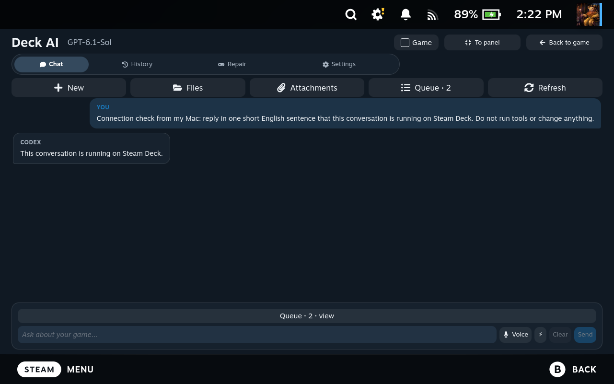

# Your computer and Steam Deck

[Project](../README.md) · [Installation](QUICKSTART.md) · [Russian guide](REMOTE-CONTROL.ru.md)

## Computer to Steam Deck

**Codex runs and executes commands on Deck. Your computer is the remote control.** Start with both devices awake on the same network and sign into ChatGPT on Deck first.

1. On Deck, open **Decky → Deck AI → Settings** and find the remote-access section. Show the connection information and note the IP address. Without Decky, use the desktop app's **+** menu to manage access from a Mac/PC; it shows the address, SSH fingerprints, server control and public-key field.
2. If SSH is off, open Konsole in Desktop Mode. Run `passwd` to set your SteamOS password if needed, then `sudo systemctl enable --now sshd`. Enter the password only on Deck.
3. On your computer, download and extract **remote-control.zip** from the [latest preview release](https://github.com/ivshalenko/codex-steamdeck/releases/tag/v1.0.0-rc.24). Install Python 3.9+ from [python.org](https://www.python.org/downloads/) and OpenSSH Client if missing. On Windows, OpenSSH Client is a Windows Optional Feature.
4. **Mac/Linux:** open a terminal in the extracted folder and run `python3 scripts/connect-deck.py`. **Windows:** open **Connect-Steam-Deck.cmd**.
5. Enter Deck's IP. The wizard creates a dedicated SSH key. Copy the displayed **public** `ssh-ed25519 …` line into Deck AI's public-key field on Deck and authorize that computer. The private key stays on your computer.
6. Continue the wizard. Compare the SSH fingerprint with the one shown on Deck and accept only a matching fingerprint. This connection does not need your Deck password.
7. Use the launcher path printed by the wizard. On Mac/Linux:

```sh
~/.local/bin/deck-remote new "Show the free space on my Steam Deck" --wait
~/.local/bin/deck-remote list
~/.local/bin/deck-remote read THREAD_ID
~/.local/bin/deck-remote send THREAD_ID "Continue the check" --wait
```

On Windows PowerShell:

```powershell
& "$HOME/.local/bin/deck-remote.cmd" new "Show the free space on my Steam Deck" --wait
& "$HOME/.local/bin/deck-remote.cmd" list
```



The reply and conversation are saved on Deck. Both devices must stay awake and reachable. If Deck's IP changes, rerun the wizard; it updates only its own `deck-ai` SSH block and backs up the configuration. Manually modified managed blocks require manual attention.

SSH lets an authorized user run commands as your Deck user. Authorize only your own public keys. To revoke a computer, remove its key line from Deck's `~/.ssh/authorized_keys`. `sudo systemctl disable --now sshd` stops all SSH access, including unrelated connections.

## Steam Deck to a computer

This direction is separate: **the computer runs Codex, and Deck is the remote control**.

1. Install the [official Codex CLI](https://github.com/openai/codex#quickstart) and sign into ChatGPT on that computer.
2. On Mac, enable System Settings → General → Sharing → Remote Login for the intended user. On Linux, install and enable OpenSSH Server using your distribution's tools.
3. On Deck, create a key with `ssh-keygen -t ed25519`. Add the public line from `~/.ssh/id_ed25519.pub` to `~/.ssh/authorized_keys` **on the computer**. Never copy the private key.
4. From Deck, run `ssh USER@COMPUTER_IP`. Compare the host fingerprint, check that key sign-in works, then use `exit` to return to Deck.
5. In the desktop app's **+** menu, configure a remote Codex with the host, SSH user and key path. Alternatively, create an SSH alias in Deck's `~/.ssh/config` and select it in Decky device settings.
6. Ask “Show the operating system and current folder.” Confirm the result belongs to the intended computer before requesting edits.

Windows as the execution host requires **WSL with Codex and an SSH server inside WSL**. Native Windows hosting is unverified. Windows as a remote-control client has a launcher, but still needs an independent real Windows-device check.

File editing remains tied to the device that opened the file. If you switch devices, unsaved edits remain in the editor; switch back to save. Saving checks the original file version and preserves its previous contents in `.deckai.bak`.

## Away from home and troubleshooting

Use your own VPN on both devices and connect to Deck's VPN address. VPN setup is separate from Deck AI. Avoid forwarding SSH port 22 from your router to the internet.

| Problem | Check |
| --- | --- |
| Connection timeout | Deck may be asleep, its IP may have changed, or the devices may be on different networks. Check the address again. |
| Permission denied (publickey) | Verify the saved public key, SSH username and selected private key. |
| Host key changed | Confirm that this is your Deck and whether it was reinstalled before updating `known_hosts`. Keep host-key checking enabled. |
| Codex not found | Install Codex and sign in on the device that executes the task. |
| Chat opens but a task does not run | Check pending action approvals and read-only mode. Open Diagnostics; reconnect after sleep if needed. |

Do not close your laptop lid or suspend Deck during a connection check. Keep passwords, private keys and account tokens out of chat messages and GitHub issues.
