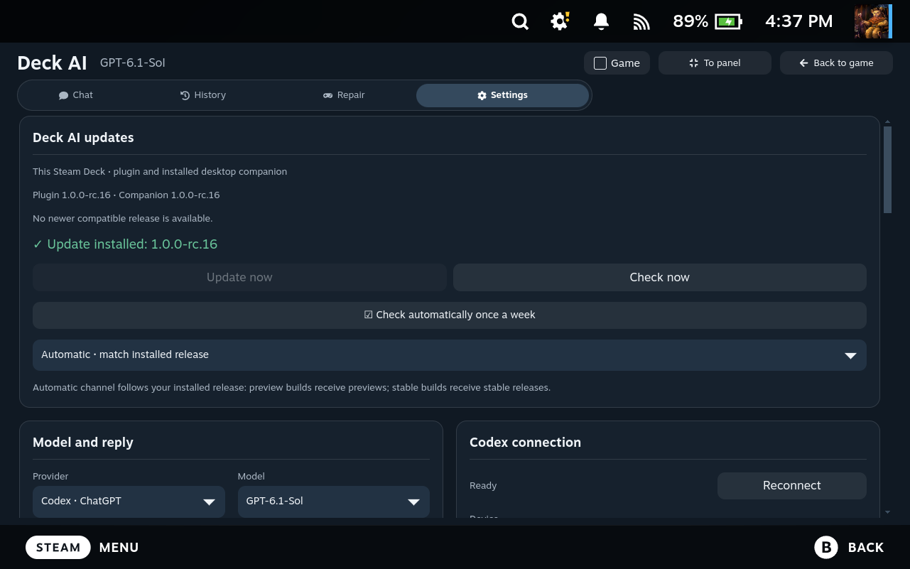

# Weekly checks and one-click updates

Deck AI checks the project's published GitHub releases **once every seven days** while Steam/Decky or the desktop app is running. The last attempt is saved, so restarting does not trigger another check. **Check now** works whenever you need it.

## On Steam Deck

1. A Steam notification announces a newer compatible release. Open it to reach **Deck AI → Settings → Deck AI updates**.
2. Finish active tasks and dictation. Save file edits and send or remove pending attachments. Text drafts are kept.
3. Press **Update now** once. Deck AI downloads and verifies the release, updates the plugin and an installed desktop companion, reloads the plugin through Decky and checks its startup.
4. The completion message shows the installed version. Keep Steam and Decky running until it finishes.

An idle desktop window saves its draft and closes so its files can be replaced. When updating from the desktop app's own **Deck AI updates** menu, the app reopens afterward. Active work and open editing dialogs block the update.

Actual English Steam Deck screen after the controlled rc.16 device trial.

## Controls

In **Settings → Deck AI updates** you can turn weekly checks on/off and choose a channel. **Automatic** follows the installed version: release candidates receive stable and preview releases; stable installations receive stable releases. A newer installed component is never silently downgraded.

A notification is remembered across restarts. If an available update is left uninstalled, it can be announced again at the next weekly check. The update card remains available in Settings. Desktop notifications use the same device preference.

## Verification and recovery

Update packages come only from published releases of `ivshalenko/codex-steamdeck`. The updater checks GitHub asset digests, `SHA256SUMS.txt`, the update manifest, archive paths, file contents and component versions. A plugin's startup check must succeed before completion is reported.

The installation runs in a detached worker, so unloading the old plugin does not interrupt the transaction. Managed code is backed up before replacement. Installation or startup failure restores the previous code; an interrupted worker can recover on the next start. A file changed independently after installation is preserved and reported for manual recovery. Code backups are kept separately from chats, credentials, models and settings.

If recovery reports that the full installer is required, open the release on GitHub and run **Install-Deck-AI.desktop** in Desktop Mode. The normal graphical installer shares the update lock and will not write concurrently with an active update. Installer/protocol or dependency changes that the current updater cannot safely handle require this route.

The updater is included starting with **rc.16**. Users of older versions install rc.16 once through the existing installer/ZIP; later compatible releases can be installed with the button. Updates are applied after your click, rather than silently during a game.
